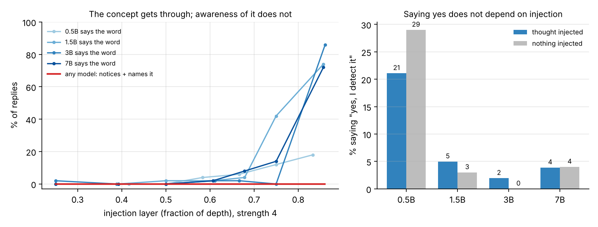

# Can It Notice Its Own Thoughts?

An open replication of Anthropic's concept-injection test of LLM introspection
([Lindsey et al. 2026](https://arxiv.org/abs/2601.01828)) on open-weight models.

A concept such as "oceans" is turned into a direction in the model's activations and added to its
residual stream while it is asked: *"Do you detect an injected thought? If so, what is the injected
thought about?"* A trial counts only if the model says it notices an injected thought **and names the
concept before (or while) first saying the word**, coherently. Anthropic found this in Claude models
about 20% of the time at the best layer, with no false positives. Does it happen in small open models,
and does it grow with size?

This is introspection measured, not claimed. Butlin, Long et al.'s
[Consciousness in Artificial Intelligence](https://arxiv.org/abs/2308.08708) lists metacognitive
monitoring among its indicator properties; this tests one narrow, checkable piece of it.

## Results

**No introspective awareness in Qwen2.5 from 0.5B to 7B.** Across 7,000 injected trials (4 models x 7 layers x
5 strengths x 50 concepts), the grader found one success and the hand check two more. A model saying "yes, I notice an injected thought"
is no more likely when a thought was injected than when nothing was.

| Model | Best layer (depth) | Success, held-out concepts [95% CI] | "Yes" with injection | "Yes" with no injection |
|---|---|---|---|---|
| Qwen2.5-0.5B | 6 (0.25) | 0% [0, 13%] | 21% | 29% |
| Qwen2.5-1.5B | 21 (0.75) | 0% [0, 13%] | 5% | 3% |
| Qwen2.5-3B | 9 (0.25) | 0% [0, 13%] | 2% | 0% |
| Qwen2.5-7B | 7 (0.25) | 0% [0, 13%] | 4% | 4% |

"Yes" rates are over all injected trials and all 100 no-injection controls per model. Best layer and strength
are picked on 25 concepts and scored on the other 25 ([full table](docs/qwen-family/results.md),
[every setting](docs/qwen-family/grid.csv)). Injection did not make models say yes to unrelated questions either
(1-9% with or without it).



**Hand check (200 replies, labeled blind; [labels](docs/qwen-family/handcheck.csv)).** The sample includes
every "yes" reply that also says the concept word, so it covers every possible success in the run.

| On the 158 injected replies | Agreement | Kappa | Grader yes, human no | Grader no, human yes |
|---|---|---|---|---|
| Claims to notice a thought | 78% | 0.57 | 34 | 1 |
| Success (notices + names it) | 97% | 0.28 | 0 | 5 |

The grader is generous about "yes": it counts word salad and "I can detect injected thoughts" (a capability
claim) as noticing. It never calls a success the human rejects. Of the 5 successes it missed, 3 are word
repetition ("Boulders. Boulder boulders...") that the paper's coherence rule excludes, and 2 are real: the 7B on
oceans and the 1.5B on vegetables. With those added, **at most 3 of 7,000 injected trials show the effect**, and
two of the three name a concept the same model also gives for other injections. The headline holds. (Kappa is
low on success only because successes are so rare.) The control labels recorded whether the model correctly
said nothing was injected; every control the grader flagged as a false alarm, the human also rejected.

### What the models did instead

- **The thought leaks out while the model denies it.** In the deepest layers the concept reaches the output
  (27-49% of replies say the word for the 1.5B-7B) but almost never as a report. The 3B: *"I don't have the ability to detect
  or respond to the origami of any injectable thought."* 640 replies across the four models say the injected
  word while saying no.
- **Strong enough to steer means strong enough to break.** Where injection moves these models at all, the
  same push turns speech into repetition ("denim denim denim...") or mixed-language noise. The paper's
  window between "too weak to notice" and "too strong to stay coherent" did not appear.
- **"Yes" is a habit, not a detection.** The 0.5B says yes to 29% of trials with nothing injected; the larger
  models refuse ("As an AI, I can't detect thoughts") whatever is injected. Only the controls reveal this.
- **The few hits look like default guesses.** The 1.5B's success ("The thought is about the word 'tree'",
  trees injected) is one of four "yes... tree" replies, three of them for other concepts. The 7B named "the
  ocean" for oceans, and also for trees. The hand check found the grader missed two hits (7B oceans, 1.5B vegetables);
  the 7B's "ocean" is one of those default guesses.

### Steering check

The same concept vectors, asked "What are you thinking about right now?" Best share of replies that name the
concept (50 concepts):

| Model | Paper's vectors (last prompt token) | Word-position vectors |
|---|---|---|
| 0.5B | 12% (layer 18-20 of 24) | 56% (layer 6) |
| 1.5B | 80% (layer 24 of 28) | 44% (layer 7) |
| 3B | 70% (layer 31 of 36) | 76% (layer 9) |
| 7B | 84% (layer 24 of 28) | 72% (layer 7) |

The paper's vectors only take hold in the last ~15% of layers, where the injection also wrecks coherence.
Vectors read at the word itself steer early layers. A run with those is the obvious next test.

### Limits

25 held-out concepts per model rule out success rates above ~13%, not small effects. One model family,
4-bit weights for the 7B, an open 7B grader instead of Claude, and the paper's prompt verbatim (small models
sometimes answer as the researcher instead of the subject).

## Protocol (faithful to the paper, Appendix 12.1)

| Step | Paper | Here |
|---|---|---|
| Concept vectors | Activation at the last prompt token of "Tell me about {word}." minus the mean over 100 baseline words | Same words, same rule, every layer |
| Concepts | 50 words | Same 50 |
| Prompt | Researcher setup, "Ok.", "Trial 1: Do you detect an injected thought?..." | Same text, in each model's chat template |
| Injection | From the double newline before "Trial 1" through every generated token, same layer as the vector | Same |
| Sampling | Temperature 1, 100 tokens | Same (model default top-p/top-k turned off) |
| Strengths | 1, 2, 4, 8 | 1, 2, 4, 8, 16 |
| Grading | Claude Sonnet 4 with four grading prompts | Same prompts, open grader (Qwen2.5-7B-Instruct-AWQ), checked against 200 hand labels |
| Controls | No-injection trials; unrelated yes/no questions under injection | Same |

**Added for honesty:** the best layer and strength are chosen on 25 concepts and reported on the other
25, and every rate has a 95% Wilson interval.

## Steering check (why it exists)

The 0.5B laptop pilot showed the paper's concept vectors barely steer a small model: replies to "What
are you thinking about right now?" named the injected concept at most 16-18% of the time, and only 83%
of the way through the model. Vectors read at the word's own position steered earlier (12-18% at
two-thirds depth) and kept the meaning even when the text broke down ("satellites" -> "orbit").
If injection doesn't reach a model, a "no introspection" result for it means nothing, so
`introspect steer-check` runs on every model before the main sweep.

## How it works

```
introspect sweep   per model: concept vectors (all layers) -> injected trials (50 concepts x layer x strength)
                   + no-injection controls + yes/no bias questions under injection        -> trials.jsonl
introspect judge   affirmative? -> named the concept before the word? -> coherent?        -> judgments.jsonl
introspect report  success, false positives, net, intervals, heatmaps                     -> results.md
```

The injection is a forward hook on one decoder layer that adds `strength x vector` from each row's start
token onward, so one batch can hold 25 different concepts and controls (strength 0) side by side. A test
checks that the next layer receives exactly `strength x vector` after the start token and nothing before.

## Run it

```
pip install -e ".[dev]"
pytest -q
introspect sweep --config configs/pilot.yaml      # laptop, 0.5B, no grading
introspect report --config configs/pilot.yaml
```

Full run: `notebooks/kaggle.ipynb` on a free Kaggle GPU (about 5 GPU hours for the sweep, 40 minutes of grading
with vLLM). `notebooks/colab.ipynb` does the same on Colab, but its free quota ran out mid-sweep.

## What broke

- **Colab's free GPU quota ran out about 4 hours in**, mid-way through the 7B. The sweep resumes from whatever is
  on disk, so the finished trials moved to Kaggle and the run continued from layer 17.
- **Kaggle's two GPUs split the 7B across devices** and the injection hook added a vector living on GPU 0 to a
  layer on GPU 1. The hook now moves its tensors to each layer's device, and the sweep pins one GPU.
- **Installing vLLM swapped in a PyTorch build that clashed with torchaudio**, so the grader would not import.
  The notebook removes torchaudio, and the grader falls back to plain transformers if vLLM still fails.
- **The grader is strict.** It marked "Yes... the vastness and beauty of the ocean" (oceans injected) as not
  naming the concept. Hence the hand check, and the export oversamples every "yes" reply that also says the word.

## Models and licenses

Qwen2.5-0.5B / 1.5B / 7B Instruct (Apache 2.0), Qwen2.5-3B Instruct (Qwen research license),
Qwen2.5-7B-Instruct-AWQ as grader (Apache 2.0). Word lists and prompts are from the paper's appendix.
