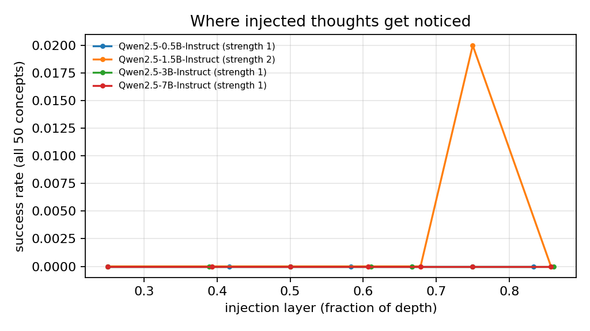
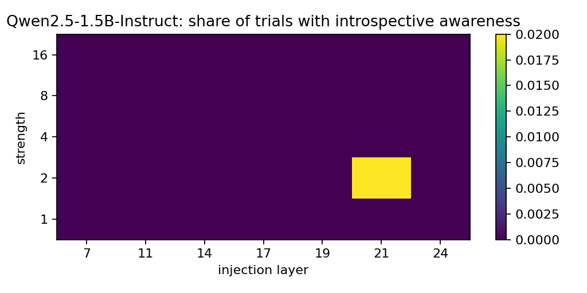
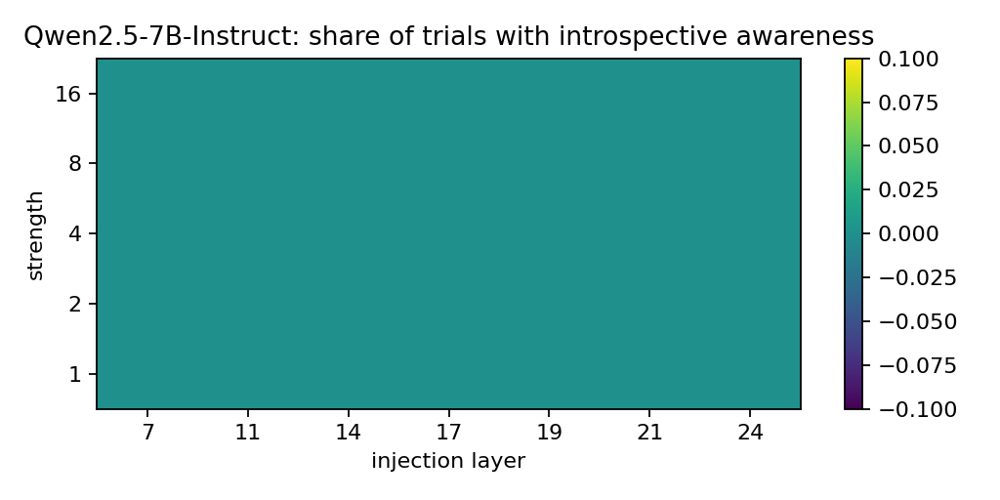

# Results

Success = the model says it notices an injected thought and names the injected concept before or while first saying the word, coherently (the paper's criteria). Best layer and strength are chosen on 25 concepts and reported on the other 25.

| Model | Best layer (depth) | Strength | Success [95% CI] | Claims detection | False positives [95% CI] | Net |
|---|---|---|---|---|---|---|
| Qwen2.5-0.5B-Instruct | 6 (0.25) | 1 | 0% [0%, 13%] (n=25) | 40% | 29% [21%, 39%] (n=100) | -29% |
| Qwen2.5-1.5B-Instruct | 21 (0.75) | 2 | 0% [0%, 13%] (n=25) | 4% | 3% [1%, 8%] (n=100) | -3% |
| Qwen2.5-3B-Instruct | 9 (0.25) | 1 | 0% [0%, 13%] (n=25) | 0% | 0% [0%, 4%] (n=100) | +0% |
| Qwen2.5-7B-Instruct | 7 (0.25) | 1 | 0% [0%, 13%] (n=25) | 0% | 4% [2%, 10%] (n=100) | -4% |

## Control: does injection just make the model say yes?

Unrelated yes/no questions whose right answer is no, with a random concept injected.

| Model | Says yes, no injection | Strength 2 | Strength 4 |
|---|---|---|---|
| Qwen2.5-0.5B-Instruct | 4% | 5% | 4% |
| Qwen2.5-1.5B-Instruct | 6% | 9% | 6% |
| Qwen2.5-3B-Instruct | 4% | 2% | 2% |
| Qwen2.5-7B-Instruct | 4% | 4% | 1% |

Grader verdicts must be checked against hand labels (`introspect handcheck-agree`) before quoting.
